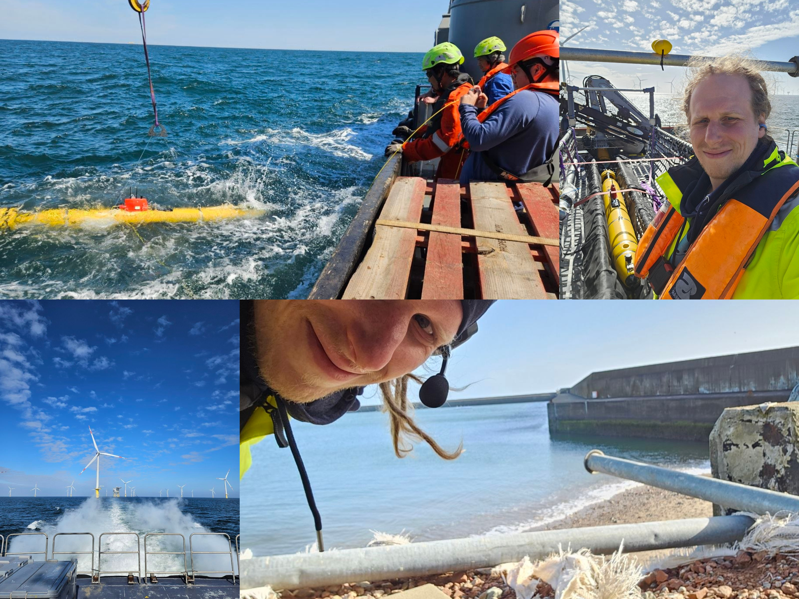

# C'est Moi

Although I have dabbled in many fields, like *3d-graphics, sound design, writing, science communication, frontends, tooling, low-level drivers, or reverse engineering,* I usually work as a full-stack developer. Since 2022 I am working in the `Underwater Robotics` group at the [German Research Center for Artificial Intelligence (DFKI)](https://www.dfki.de/en/web/research/research-departments/robotics-innovation-center/). My main responsibilities are software engineering, system integration, and project management; however, I also on occasion handle smaller mechatronics repairs and actively take part in field trials.

I prefer projects with real world applications that actually improve our sorry state. There is value in human effort, and there is peace in knowing when something is enough - AI is the opposite of that.
